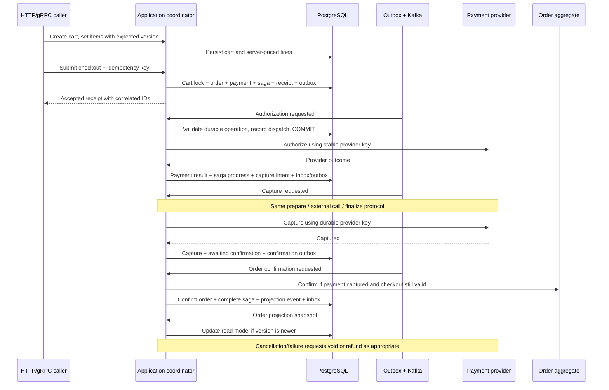

# Rust service template

One codebase, several Kubernetes workloads. This template demonstrates a checkout
flow across orders, payments, PostgreSQL and Kafka, with HTTP and gRPC entry points.
It includes local Compose infrastructure, Testcontainers tests, GitLab MR coverage,
container builds, operational defaults and concise AI-agent guidance.

**The provider adapter is simulated; payment and checkout state are durable. Authentication and authorization belong to
your company's gateway/service integration. Do not expose these sample APIs to
untrusted clients before implementing that boundary.** `API_AUTH_MODE=upstream`
acknowledges that deployment requirement; it does not authenticate a request.

## Start here

| Task | Where |
| --- | --- |
| Run the whole example | [Quick start](#quick-start) |
| Understand business/transaction boundaries | [Architecture](#architecture) |
| Add your own service or domain slice | [Customize the template](#customize-the-template) |
| Configure your dependency mirror or restricted network | [Dependency supply chain](#dependency-supply-chain) |
| Set up MR checks and coverage | [GitLab CI](#gitlab-ci) |
| Review deployment requirements | [Production acceptance](#production-acceptance) |
| Give a coding agent the important context | [AGENTS.md](AGENTS.md) |
| See what was actually verified | [Validation record](#validation-record) |

## Stack and deployables

Rust 2024 edition, pinned Rust **1.99.1**, Tokio, Axum **0.8**, Tonic/Prost **0.14**,
SQLx **0.9**, PostgreSQL **18.6**, rust-rdkafka **0.39**, tracing, OpenTelemetry
**0.33**, tracing-opentelemetry **0.34**, and Testcontainers **0.28**. The committed
`Cargo.lock` is the authority for resolved versions. Update it deliberately; no
`latest` tags or unconstrained executable downloads are part of service builds.

| Binary | Responsibility | Process model |
| --- | --- | --- |
| `http-api` | Cart/checkout commands and order/payment queries through Axum | Deployment |
| `grpc-api` | The same use cases through Tonic | Deployment |
| `kafka-outbox-poller` | Lease pending events, publish, then mark delivery | Deployment; multiple replicas supported |
| `kafka-consumer` | Execute payment operations, advance sagas, confirm orders and update projections | Deployment; Kafka consumer group |
| `cronjob` | Request compensation for expired checkouts in bounded batches | Kubernetes CronJob; exits when done |
| `migrate` | Apply embedded SQL migrations | One-off release Job |

Each runtime image contains its own binary. Replicas, resources and release timing
can differ per workload. The database is intentionally shared: this is a modular
service with multiple processes, not a demonstration of independently owned
microservice databases or distributed transactions.

## Quick start

Prerequisites for the full example: Docker Engine/Desktop with Compose v2 and
BuildKit, `make`, and enough Docker memory for the Kafka JVM and a Rust build
(start with 6–8 GiB). Native Rust is optional for the all-container path. The first
tools build compiles pinned coverage/audit tools from source and will take longer
than subsequent application builds. Container release builds default to two Cargo
jobs; use `CARGO_BUILD_JOBS=1 make images` (or set it in `.env` for Compose) on a
small VM. Thin-LTO links for several binaries can otherwise exhaust memory.
Do not run container compilation and broker tests concurrently on a small VM.

```sh
make tools
make up
docker compose ps -a
curl --fail http://localhost:8080/health/ready
```

`make tools` prepares local builder and runtime bases. `make up` starts PostgreSQL,
Kafka, a topic provisioning job, an OTEL Collector, migrations and the four
long-running services. Compose waits for database/broker readiness and successful
migrations/topic creation before starting the applications. The collector prints
received telemetry to its logs; replace its debug exporter with your backend.

Local ports bind to loopback:

| Endpoint | Address |
| --- | --- |
| HTTP | `http://localhost:8080` |
| gRPC | `localhost:50051` |
| PostgreSQL | `localhost:5432` |
| Kafka from the host | `localhost:19092` |
| OTLP HTTP | `http://localhost:4318` |
| HTTP / gRPC / publisher / consumer health | `localhost:9001` / `9002` / `9003` / `9004` |

Create an empty cart. Customer identity is supplied explicitly only for the demo;
company integrations must derive and authorize it from the authenticated caller.

```sh
curl --fail-with-body http://localhost:8080/v1/carts \
  -H 'Content-Type: application/json' \
  -d '{"customer_id":"701a9338-67bc-48bc-a198-a22af1779b5c"}'
```

Copy the returned `cart_id` into `CART_ID`. Its initial version is `0`. Add two
items in separate commands. Prices come from the server catalog: `BOOK` is 2,500
minor USD units; `COFFEE` is 700. Item writes set the quantity for that SKU.

```sh
CART_ID=RETURNED_CART_UUID
curl --fail-with-body -X PUT "http://localhost:8080/v1/carts/$CART_ID/items" \
  -H 'Content-Type: application/json' \
  -d '{"sku":"BOOK","quantity":2,"expected_version":0}'
curl --fail-with-body -X PUT "http://localhost:8080/v1/carts/$CART_ID/items" \
  -H 'Content-Type: application/json' \
  -d '{"sku":"COFFEE","quantity":1,"expected_version":1}'
curl --fail-with-body "http://localhost:8080/v1/carts/$CART_ID"
```

The cart now has version `2` and total `5700`. A stale version returns a conflict;
read the current cart and reconcile the change before retrying. To remove an item,
use `DELETE /v1/carts/{id}/items/{sku}?expected_version=N` and use the returned
version on the next command. An empty cart cannot be submitted.

Submit checkout with a new UUID idempotency key and a demo payment-method token:

```sh
curl --fail-with-body http://localhost:8080/v1/checkouts \
  -H 'Content-Type: application/json' \
  -H 'Idempotency-Key: 6b4d0efa-4711-43ce-9fc7-e64ea7d314b3' \
  -d "{\"cart_id\":\"$CART_ID\",\"expected_cart_version\":2,\"payment_method_token\":\"pm_demo_approve\"}"
```

HTTP `202` means the durable workflow was accepted, not that payment succeeded.
The receipt contains `checkout_id`, `cart_id`, `order_id` and `payment_id`. Use the
returned IDs to watch each independent resource:

```sh
curl --fail-with-body http://localhost:8080/v1/checkouts/RETURNED_CHECKOUT_UUID
curl --fail-with-body http://localhost:8080/v1/payments/RETURNED_PAYMENT_UUID
curl --fail-with-body http://localhost:8080/v1/orders/RETURNED_ORDER_UUID
curl --fail-with-body http://localhost:8080/v1/orders/RETURNED_ORDER_UUID/summary
```

With the worker running, payment progresses through authorization and capture;
only then is the order confirmed and checkout completed. The order-summary query
is an asynchronous projection and may initially be absent or lag the current order.
An exact checkout retry returns the original accepted receipt, including its initial
status; use GET for progress. Reusing its key with different arguments returns
HTTP `409` / gRPC `AlreadyExists`. The cart cannot be submitted a second time under
another key. Read models never return the payment-method token.

For a decline, create another cart, add an item, then submit with a new request key
and `pm_demo_decline`. To explore pending cancellation, stop the consumer, submit a
checkout, `POST /v1/checkouts/{checkout_id}/cancel`, then restart it. The saga voids
an authorization or refunds a capture when necessary. Completed checkouts reject
this endpoint; a post-purchase return is a separate use case.

For gRPC, use a company-installed `grpcurl` or generated client. Reflection is not
needed; the repository contains the versioned protobuf sources:

```sh
grpcurl -plaintext -import-path crates/contracts/proto \
  -proto commerce/v1/cart.proto \
  -d '{"customerId":"701a9338-67bc-48bc-a198-a22af1779b5c"}' \
  localhost:50051 commerce.v1.CartService/CreateCart
# Use the returned cart ID in both following requests.
grpcurl -plaintext -import-path crates/contracts/proto \
  -proto commerce/v1/cart.proto \
  -d '{"cartId":"RETURNED_CART_UUID","sku":"BOOK","quantity":1,"expectedVersion":0}' \
  localhost:50051 commerce.v1.CartService/AddItem
grpcurl -plaintext -import-path crates/contracts/proto \
  -proto commerce/v1/checkout.proto \
  -d '{"idempotencyKey":"ba373f29-e935-441a-8b4f-8645390e2af9","cartId":"RETURNED_CART_UUID","expectedCartVersion":1,"paymentMethodToken":"pm_demo_approve"}' \
  localhost:50051 commerce.v1.CheckoutService/Checkout
```

`CartService`, `CheckoutService`, `OrderService` and `PaymentService` expose the
same application use cases as HTTP. Mixing transports does not change idempotency
or transaction semantics.

```sh
make logs                          # JSON application logs and collector output
make cron                          # Expire overdue checkouts, then exit
docker compose stop kafka-consumer # Pause workflow processing while exploring
docker compose start kafka-consumer
make down                          # Keep PostgreSQL/Kafka volumes
```

Checkout deadlines are 30 minutes. Expiry requests compensation; the consumer
must run to finish any provider void/refund. It does not simply relabel a captured
payment as cancelled. `docker compose down -v` intentionally deletes local data.

## Architecture

```text
crates/
  shared-kernel/          small checked-money and domain-error vocabulary
  cart/                   mutable cart aggregate and item/version rules
  orders/                 order aggregate and immutable purchase snapshot
  payments/               payment aggregate, durable operations, provider port/demo
  checkout/               checkout saga state machine and compensation decisions
  commerce/
    src/application/      commands, queries, event handlers and workflow coordination
    src/infrastructure/   per-domain SQLx repositories, unit of work, inbox/outbox
    tests/                real PostgreSQL rollback/concurrency/recovery tests
  contracts/              versioned protobuf; protox generation without protoc
  platform/               validated env, JSON logging, OTLP and signals
  services/
    src/api/              HTTP routes, DTOs, handlers, errors and middleware
    src/grpc/             per-domain gRPC services and wire mapping
    src/kafka/            client configuration, producer, consumer and trace carrier
    src/bin/              six small executable entry points
    tests/                HTTP/gRPC/PostgreSQL/Kafka end-to-end tests
migrations/               forward SQL migrations for the shared database
deploy/                   collector, Kubernetes workloads and policy examples
scripts/                  CI, builds, coverage and dependency intake
```

The domain crates have no Axum, Tonic, SQLx or Kafka dependency. Each owns its state
transitions; the order does not own a payment-status enum. `commerce` composes these
modules and owns explicit PostgreSQL units of work. Adapters validate wire data,
invoke use cases and translate results. `shared-kernel` is deliberately small;
it is not a shared folder for arbitrary business rules.

The [supplied Rust structure article](https://rivelbabindamana.com/en/articles/rust-backend-structure/)
informs the separation of domain, application, persistence and transport. Here the
business boundaries are also Cargo boundaries. This is a **modular service with a
shared database and multiple deployable processes**. It does not pretend that a
local SQL transaction is a transaction across independently owned microservices.

### Aggregates and workflow

| Module | Owns | Does not own |
| --- | --- | --- |
| Cart | Empty cart, quantities, server-priced lines, optimistic version, checkout lock | Payment decisions or order fulfillment |
| Orders | Customer and purchased-line snapshot, awaiting-payment/confirmed/cancelled lifecycle | Provider state or payment retry policy |
| Payments | Amount/currency, provider references, authorization/capture/void/refund, pending operation and cancellation intent | Cart edits or order confirmation |
| Checkout | Durable correlation of cart/order/payment, deadlines, progress and compensation | Provider-specific APIs |

A cart starts empty. Item commands specify the expected cart version; concurrent
edits cannot silently overwrite one another. Catalog lookup runs server-side.
Checkout revalidates active catalog prices under a database lock, freezes the
purchase snapshot, and rejects an empty, stale or previously submitted cart. A
price change returns a conflict: update the affected cart quantities to refresh
the server quote, review the new total, then resubmit. An inactive SKU must be
removed; an old cart cannot bypass its availability check. Money is checked integer minor units, never floating-point math.
This sample has a fixed USD catalog; taxes, discounts, inventory, shipping and
multi-currency settlement require their own domain rules and tests.



The saga uses explicit persisted state and commands/events. Each step has its own
local commit and outbox entry. Payment authorization, capture and order confirmation
are distinct steps, with visible intermediate states. After a provider response,
the coordinator advances payment and saga state in one local transaction and
emits the next command. Payment-completion events are audit/integration facts;
the workflow does not depend on consuming those facts again in delivery order.
Order confirmation has its own command handler and follows successful capture. A completed checkout is not cancelled by the pending-checkout
cancellation endpoint; post-purchase returns are a separate business use case.

A provider timeout is an **unknown outcome**, not proof of a decline. The worker
persists an operation before calling the provider, closes the transaction, and
uses a stable provider idempotency key. If it crashes after the provider succeeds,
redelivery retries that same operation/key. Recording the response, its durable
effects and subsequent events is transactional. Cancellation during an in-flight
operation records intent: a late authorization must be voided, and a late capture
must be refunded. Compensation can itself fail; unresolved compensation must remain
visible for reconciliation rather than being labelled a successful cancellation.

`PaymentGateway` is the integration port; `DemoGateway` is a deterministic local
adapter. The consumer refuses to start with this adapter in `APP_ENV=production`;
wire the company provider at the composition boundary before enabling production. It exercises authorize/capture and void/refund without processing money.
Real adapters need authenticated provider APIs, bounded calls, verified callbacks,
provider reconciliation and an explicit policy for the provider's idempotency-key
retention window. Never retry an uncertain real payment with a fresh key merely
because the previous request timed out. This example models one full authorization/capture and full void/refund per
payment. Partial captures/refunds, multiple payment attempts, 3-D Secure/customer
action and provider webhooks need explicit additional states and operation sequences.
The demo is not a card vault or a complete payment product.

### CQRS without event sourcing

Commands use the aggregate repositories and enforce invariants. Query DTOs are
separate: normal resource reads expose current committed state without payment
credentials, while the order-summary endpoint reads an asynchronously maintained
projection. The snapshot carries the checkout workflow version; version guards prevent a
late event from replacing a newer projection.
Clients must tolerate projection lag and use command receipts/current resource
reads when they need immediate state. This is CQRS in one PostgreSQL database;
aggregate state is stored directly, so it is **not event sourcing**.

Repositories store validated aggregate snapshots in JSONB, with relational identity,
uniqueness, foreign-key and workflow/index columns. This keeps the domain model
separate from SQL row layout; changing a persisted snapshot still requires a
compatible migration/reader rollout. Payment operations have a separate durable
request/result history and dispatch timestamps. Reporting reads the projection;
it does not need access to internal payment requests or their opaque tokens.

### Transactions and delivery guarantees

- **Checkout unit of work:** the cart transition, order snapshot, independent
  payment, saga, immutable request receipt and first outbox message commit together.
  A transaction-scoped advisory lock serializes the same request key; conflicting
  reuse is rejected. An exact retry returns the original accepted receipt, while
  GET endpoints return current progress.
- **Provider boundary:** prepare an operation transactionally, call the provider
  outside the transaction, then persist its result transactionally. Retryable or
  ambiguous errors leave durable pending work. Provider keys, aggregate locks and
  transition guards protect retries across process restarts.
- **Publishers:** short `FOR UPDATE SKIP LOCKED` claims use expiring, fenced lease
  tokens. Claim immediately before sending. Record delivery only after Kafka ACK.
  Retries use exponential backoff capped at 256 seconds.
- **At-least-once delivery:** a crash after Kafka ACK and before the database update
  can publish again. Kafka producer idempotence does not close that gap. Inbox
  receipts and durable transitions make consumer replay safe. No distributed
  exactly-once claim is made.
- **Consumer acknowledgement:** auto-commit and auto-offset-store are disabled.
  Validate the immutable event, commit durable effects, then commit offset `N + 1`.
  A failed record stops processing; a later record never commits past it. Provider
  retry errors also leave the record uncommitted.
- **Ordering:** events carry aggregate/correlation identity and are keyed for Kafka.
  Order projection snapshots also carry a workflow version.
  Leased concurrent publishers can still reorder delivery. Transition/idempotency
  guards and projection version checks are required; partitioning alone is not an
  aggregate ordering guarantee.
- **Poison records:** invalid/unsupported/mismatched events fail the consumer and
  leave the offset uncommitted. Investigate, repair the cause and restart. Adding
  a quarantine/DLQ requires durable quarantine and explicit replay/acknowledgement
  semantics; catching an error and continuing is not a substitute.
- **Event trust boundary:** the internal consumer checks each envelope against its
  retained outbox payload. This topic is for this application's own workflow. An
  external-domain consumer needs a separate versioned contract, producer trust/ACL
  policy and source-aware inbox; do not silently bypass verification on this topic.
- **Retention:** original outbox payloads, inbox receipts, provider operations and
  request receipts are part of replay correctness. Set their retention together
  with broker replay and provider idempotency windows before implementing cleanup.

SQL uses bound parameters with `query`/`query_scalar`; builds need no database or
`.sqlx` snapshot. **The real PostgreSQL tests validate SQL.** Teams adopting SQLx
`query!` should commit offline metadata and add `cargo sqlx prepare --check` to CI.
The template does not claim compile-time schema checking for runtime queries.

## Native development

Install the pinned Rust toolchain through your approved toolchain distribution,
plus a C/C++ compiler, `make`, Perl and standard development libraries. macOS
requires Xcode command-line tools. `librdkafka` and OpenSSL compile from crate
source; no CMake requirement is introduced by the chosen Kafka build mode.
The prepared Linux tools image includes CMake for other native dependencies.
`protox` compiles protobuf in Rust, without an external `protoc` executable.

```sh
cp .env.example .env
docker compose up -d postgres kafka kafka-init otel-collector
set -a
. ./.env
set +a
cargo run --locked -p services --bin migrate
HEALTH_ADDR=127.0.0.1:9001 cargo run --locked -p services --bin http-api
```

In separate terminals with the same environment:

```sh
HEALTH_ADDR=127.0.0.1:9002 cargo run --locked -p services --bin grpc-api
HEALTH_ADDR=127.0.0.1:9003 cargo run --locked -p services --bin kafka-outbox-poller
HEALTH_ADDR=127.0.0.1:9004 cargo run --locked -p services --bin kafka-consumer
cargo run --locked -p services --bin cronjob
```

Load `.env` only from a trusted local checkout. The application itself reads the
process environment, not `.env` files. Compose's environment is explicitly defined
in `compose.yaml`; its `.env` file supplies interpolation, not every application
setting. Stop container API workloads before running native processes on the same
ports. For a remote Docker daemon, Kafka's advertised listener must be reachable
from the client; `localhost` in Compose is intended for a local engine.

## Configuration and observability

Configuration is loaded and validated before work starts. Secret-bearing settings
do not implement `Debug`. Invalid values fail startup without printing secrets.

| Variable | Default / purpose |
| --- | --- |
| `APP_ENV` | `local`; accepts `local`, `test`, `production` |
| `DATABASE_URL` | Required; production requires exactly one `sslmode=verify-full` |
| `DB_MAX_CONNECTIONS` | `10` per process; budget across all replicas |
| `HTTP_ADDR`, `GRPC_ADDR`, `HEALTH_ADDR` | Native loopback ports `8080`, `50051`, `9000`; Compose/Kubernetes bind all interfaces |
| `API_AUTH_MODE` | `local-unsafe`; production APIs require explicit `upstream` acknowledgement |
| `KAFKA_BROKERS` | `localhost:19092` for native local development |
| `KAFKA_TOPIC`, `KAFKA_GROUP_ID` | `commerce.events.v1`, `commerce-workflows-v1` |
| `KAFKA_SECURITY_PROTOCOL` | Local `PLAINTEXT`; production workers require `SSL` or `SASL_SSL` |
| `KAFKA_SASL_MECHANISM`, `KAFKA_SASL_USERNAME`, `KAFKA_SASL_PASSWORD` | Required together for SASL; never committed |
| `KAFKA_SSL_CA_LOCATION` | Optional mounted CA bundle for Kafka |
| `REQUEST_TIMEOUT_SECONDS` | `10`; HTTP/gRPC deadline |
| `SHUTDOWN_TIMEOUT_SECONDS` | `25`; in-flight service drain budget |
| `POLL_INTERVAL_MS`, `OUTBOX_BATCH_SIZE` | `500`, `50`; publisher work per turn |
| `OUTBOX_LEASE_SECONDS`, `EXPIRY_BATCH_SIZE` | `60`, `100` |
| `RUST_LOG`, `LOG_BUFFER_LINES` | `info`, `8192` bounded JSON stdout queue |
| `OTEL_ENABLED` | Enabled when an endpoint is configured; explicit override supported |
| `OTEL_EXPORTER_OTLP_ENDPOINT` | OTLP HTTP base URL; signal paths appended |
| `OTEL_EXPORTER_OTLP_TRACES_ENDPOINT`, `OTEL_EXPORTER_OTLP_METRICS_ENDPOINT` | Optional full per-signal URLs |
| `OTEL_EXPORTER_OTLP_TIMEOUT` | Milliseconds; default `3000`, example environment/Compose `2000` |
| `OTEL_METRIC_EXPORT_INTERVAL` | Milliseconds; default `10000` |
| `TELEMETRY_SHUTDOWN_TIMEOUT_SECONDS` | `5`; final export and log drain budget |

SQL connections set 10-second statement and 3-second lock deadlines, with a
5-second pool acquisition timeout. Tune these budgets together with request,
shutdown and Kubernetes deadlines. Lease duration must exceed a broker delivery
attempt plus the mark-published operation.

Logs are structured JSON on stdout through a nonblocking, bounded queue. Overload
can drop log lines; shutdown reports the drop count. Logs are not a durable audit
ledger. `RUST_LOG` filters both events and span creation; keep the relevant
instrumentation levels enabled for traces. Traces use a batch exporter, metrics a
periodic exporter, and resource
attributes identify service, version and environment. OTLP authentication headers
can be injected using the exporter's standard environment variables; keep them in
your secret manager. Use HTTPS to an authenticated collector or a protected local
collector hop in production.

HTTP/gRPC accept W3C trace context. Checkout persists context with its outbox event;
the publisher injects its send-span context into Kafka headers and the consumer
uses those headers, with the original event context as a fallback. The stored
event remains unchanged. Structured events such as `checkout.accepted`,
`commerce.event.processed`, `outbox.retry`, and `checkouts.expired` demonstrate custom events.
Counters cover accepted checkout requests, processed events, deliveries and expiry;
HTTP request duration uses method, route template and status labels. Do not add
order/customer IDs to metric labels. Do not log bodies, authorization headers,
payment credentials or database connection strings. The collector receives traces
and metrics; stdout collection is a separate deployment concern.

`/health/live` reports process liveness without database/broker dependencies.
`/health/ready` checks readiness and becomes unavailable during shutdown. Workers
also require a reachable broker/topic. gRPC includes the standard health service.
On SIGTERM/SIGINT, the process stops taking work, drains in-flight operations,
closes resources, then flushes telemetry. Default budgets total up to 37 seconds
(including bounded native cleanup and runtime teardown), within the example pod's
45-second termination allowance. Increase that pod allowance if you increase the
configured budgets. Deadline failures return a nonzero exit.
SIGKILL cannot drain or flush; correctness comes from transactions, leases and inbox
deduplication, not shutdown timing alone.

## Tests and coverage

```sh
make test              # Unit tests plus local OTLP export integration; no Docker
make test-integration  # Ignored Testcontainers tests; Docker is mandatory
make check             # Format check, strict Clippy, default tests
make coverage          # Both suites, Cobertura + HTML + line-coverage gate
```

`make fmt` checks formatting; use `cargo fmt --all` to rewrite it. `make build`
builds all deployables. Integration tests are marked `#[ignore = "requires Docker"]`
for fast local work, and **CI explicitly includes them**. They do not silently pass
when Docker is missing. Tests allocate disposable databases/brokers and dynamic
ports; they do not use your Compose database. Container tests/coverage default to
`TEST_THREADS=1` to bound database/JVM resource use; increase it after sizing your runner.

Meaningful cases include checked money arithmetic, invalid requests, stable
idempotent receipts, concurrent matching/conflicting requests, rollback after a
forced database failure, inbox rollback/deduplication, payment/expiry races,
competing publishers, stale lease fencing, broker round-trips, poison-message
offset safety, transport error sanitization, readiness and bounded shutdown.
The local OTLP test receives real protobuf payloads and verifies final trace/metric
export. See [validation](#validation-record) for executed checks and remaining gaps.

Coverage comes from `cargo-llvm-cov`, with matching toolchain LLVM tools preinstalled.
One instrumented test run produces `coverage/cobertura.xml`, `coverage/summary.json`
and `coverage/html/`. The script prints `LINE_COVERAGE=…%`, specifically line coverage,
and fails below `COVERAGE_MIN_LINES` (initial policy: **70%**). This is a starting
gate, not a measured quality claim. Review the first full Docker-enabled report
before adopting a company threshold; do not add broad source exclusions to pass it.

## Dependency supply chain

Local bootstrap defaults use public sources. Company CI requires approved images
and an explicit source replacement; the repository cannot enforce a runner firewall.

### Where dependencies come from

Cargo normally downloads crate **source archives**, then compiles them. Its
[source replacement](https://doc.rust-lang.org/cargo/reference/source-replacement.html)
is the equivalent of putting a company proxy/mirror in front of the public package
service. A mirror must preserve upstream package contents. The mirror index's
[`config.json` download URL](https://doc.rust-lang.org/cargo/reference/registry-index.html)
must also point to an approved archive endpoint; mirroring only the index leaves
downloads going to crates.io. Company-private crates belong in a separate named
registry, not in a crates.io replacement containing invented packages.

Upstream GitHub locations are useful for review and for building an internal
dependency intake service:

| Component | Upstream source |
| --- | --- |
| Rust / Cargo | [rust-lang/rust](https://github.com/rust-lang/rust), [rust-lang/cargo](https://github.com/rust-lang/cargo) |
| Tokio / Axum | [tokio-rs/tokio](https://github.com/tokio-rs/tokio), [tokio-rs/axum](https://github.com/tokio-rs/axum) |
| Tonic / Prost | [hyperium/tonic](https://github.com/hyperium/tonic), [tokio-rs/prost](https://github.com/tokio-rs/prost) |
| SQLx | [launchbadge/sqlx](https://github.com/launchbadge/sqlx) |
| Kafka Rust client | [fede1024/rust-rdkafka](https://github.com/fede1024/rust-rdkafka) |
| OpenTelemetry | [open-telemetry/opentelemetry-rust](https://github.com/open-telemetry/opentelemetry-rust) |
| Coverage / dependency policy | [taiki-e/cargo-llvm-cov](https://github.com/taiki-e/cargo-llvm-cov), [EmbarkStudios/cargo-deny](https://github.com/EmbarkStudios/cargo-deny) |
| Vulnerability database | [RustSec/advisory-db](https://github.com/RustSec/advisory-db) |

Switching the direct dependencies to Git URLs does **not** redirect their
transitive crates.io dependencies. It also changes package identity and review
inputs. Keep the committed `Cargo.lock`; use one of the two approaches below when
a firewall permits GitHub but not crates.io. Source package archives are not
necessarily identical to repository snapshots; do not substitute arbitrary Git
archives under existing crate checksums.

#### Company mirror

Copy `.cargo/company.toml.example` to ignored `.cargo/company.toml`, replace the
sample URL, and run:

```sh
cargo --config .cargo/company.toml fetch --locked
cargo --config .cargo/company.toml test --workspace --frozen
```

The alternate filename is not loaded automatically by Cargo. After selecting the
company registry, put its credential-free source replacement in `.cargo/config.toml`
in your derived template so Make, editors and normal Cargo commands inherit it.
`CARGO_SOURCE_CONFIG` is consumed by this repository's intake/CI/image helpers; it
is not a built-in Cargo environment variable.

For an authenticated mirror, provide a scoped, read-only
`CARGO_REGISTRIES_COMPANY_TOKEN` through the company's credential mechanism.
The example uses Cargo's token provider; local developer machines can use an
[OS credential provider](https://doc.rust-lang.org/cargo/reference/registry-authentication.html).
Never commit tokens or embed them in the index URL. Disable public registry egress
at the runner/network boundary if company policy requires exclusive mirror access.

#### Approved offline artifact, distributed through GitHub or another allowed host

On the approved dependency-intake machine, with the exact reviewed lockfile:

```sh
CARGO_SOURCE_CONFIG=.cargo/company.toml bash scripts/vendor.sh
```

This runs `cargo vendor --locked --respect-source-config --versioned-dirs`.
[`--respect-source-config` matters](https://doc.rust-lang.org/cargo/commands/cargo-vendor.html):
Cargo otherwise ignores mirror replacement while vendoring. Publish
`artifacts/vendor.tar.gz`, `artifacts/Cargo.lock`, and `artifacts/SHA256SUMS` through
your approved authenticated release channel, bound to the repository revision.
Review/sign the artifact according to company policy. A hash shipped beside an
untrusted archive is not an authenticity proof.

On the restricted machine, verify the artifact using that trusted channel,
compare its lockfile with the repository's, and extract `vendor/` at repository
root. Review archive paths before extracting externally supplied archives. Then:

```sh
cargo --config .cargo/vendor.toml.example build --workspace --bins --frozen
cargo --config .cargo/vendor.toml.example test --workspace --frozen
DEPENDENCY_MODE=vendor bash scripts/build-images.sh
```

The vendored Docker stage requires `vendor/` in the build context and performs no
dependency fetch. It still needs already available approved builder/runtime
images. The CI vendor mode assumes your company artifact-preparation step has
materialized `vendor/` **before** `ci-prepare.sh`; this template does not guess an
artifact URL or download unverified archives. Changes to dependencies require a
new reviewed vendor artifact. RustSec data is separate: provide a fresh approved
database and run `cargo deny --frozen check` in fully offline environments; the
configured maximum advisory age is seven days.

### Builder and runtime images

`make tools` builds two local bootstrap images from `Dockerfile.tools`:

- `rust-template-tools:local`: Rust 1.99.1, rustfmt, Clippy, LLVM tools, native
  compilation tools, Python, Docker CLI, cargo-llvm-cov 0.9.1 and cargo-deny 0.20.2.
- `rust-template-runtime:local`: Debian bookworm, CA certificates, libgcc and zlib;
  processes run as UID/GID 65532. OpenSSL/librdkafka are compiled from source by
  the selected crate features. Protobuf generation uses the Rust parser.

Rustup components are toolchain binaries, separate from Cargo source archives.
Prepare them in the approved tools image; `Dockerfile.tools` accepts
`--build-arg RUSTUP_DIST_SERVER=https://YOUR_APPROVED_RUST_MIRROR` for the pinned
component intake. [Rustup mirror configuration](https://rust-lang.github.io/rustup/environment-variables.html)
does not replace the Cargo mirror. Application builds/CI set `RUSTUP_AUTO_INSTALL=0`
to fail if the prepared toolchain is missing, instead of silently downloading one.

The bootstrap Dockerfile uses public version tags and signed distribution
packages for convenience; it is **not** an immutable company build environment.
To establish one, supply approved `RUST_BASE` and `RUNTIME_BASE` image digests,
configure your approved OS package repository/snapshot, build/review/scan these
images, and publish them in the company registry. Tool intake first uses a
disposable manifest with exact versions to locate approved Cargo source packages;
it never compiles that disposable graph. It copies each tool's source package and
fetches dependencies using that package's unchanged, bundled `Cargo.lock`.
Only Cargo metadata/fetch run while the read-only registry token is available.
The following build step runs `cargo install --path ... --frozen` with no network
and no registry-token mount or environment. This preserves each tool's published
dependency lock independently and prevents its build scripts from reading the
intake token. No executable release assets are downloaded.
Cargo install has [different configuration-discovery rules](https://doc.rust-lang.org/cargo/commands/cargo-install.html)
for registry and path installs, so the workflow explicitly supplies its Cargo
configuration throughout. The
configuration secret must contain only mirror settings; credentials belong in
the separate token secret. The approved base image must also contain no embedded
credentials.

```sh
docker build -f Dockerfile.tools --target tools \
  --build-arg RUST_BASE="$APPROVED_RUST_BASE" \
  --secret id=cargo-config,src=.cargo/company.toml \
  --secret id=cargo-token,env=CARGO_REGISTRIES_COMPANY_TOKEN \
  -t company-registry.example/rust-tools:reviewed .
```

Omit the token secret for an anonymous mirror. Use a corresponding `runtime`
target build with `RUNTIME_BASE` to create the runtime image. Resolve real digests
after publication; never fill the examples with invented digest values. Pinning
requires a regular update process for security fixes.

Both Dockerfiles use the approved BuildKit daemon's bundled Dockerfile frontend;
there is no `# syntax=` directive implicitly pulling a mutable public frontend.
Pin/review the daemon and its bundled frontend in the runner setup, and ensure it
supports secret/cache mounts and `RUN --network=none`.

The application Dockerfile fetches locked sources into an image layer before
copying frequently changing source files. Compilation uses `--frozen` with
[`RUN --network=none`](https://docs.docker.com/reference/dockerfile/#run---networknone).
All six executables share one compilation stage. The optional BuildKit target
cache speeds repeated builds; source archives remain in a real layer, so deleting
the cache mount does not break a cached fetch step. Persistent builder caches help
repeat builds on the same daemon; ephemeral runners may rebuild dependencies.
Cache only within the same trust boundary, never from untrusted fork pipelines.

Only the selected binary reaches each final image. Build credentials use
[secret mounts](https://docs.docker.com/build/building/secrets/) during fetching;
tool and application compilation receive no registry token. Neither Cargo
lockfiles nor source compilation prove that dependencies are safe. Build scripts
execute code, and Cargo offline mode alone is not a network boundary. These
controls improve dependency repeatability; byte-for-byte reproducible binaries
have not been demonstrated.


## GitLab CI

First prepare approved tools/runtime images using `Dockerfile.tools`, publish them
through your company's release process, then configure:

| Input | Required setup |
| --- | --- |
| `RUST_TOOLS_IMAGE` | Company builder image pinned by `@sha256:…` |
| `RUST_RUNTIME_IMAGE` | Company runtime base pinned by `@sha256:…` |
| `TEST_POSTGRES_IMAGE`, `TEST_KAFKA_IMAGE` | Approved PostgreSQL/Kafka test images pinned by `@sha256:…`; local tests default to public version tags |
| `CARGO_SOURCE_CONFIG` | GitLab **file** variable with approved Cargo source replacement |
| `CARGO_REGISTRIES_COMPANY_TOKEN` | If required: short-lived, masked, read-only dependency token |
| Runner tag `rust-docker-isolated` | Isolated runner with usable Docker socket and reachable container ports |
| `TESTCONTAINERS_HOST_OVERRIDE` | Set to the Docker host reachable from the job container when socket mounting requires it |

The pipeline runs on MRs, default-branch commits and manual web runs. It checks
formatting, treats Clippy warnings as errors, runs all tests with coverage, checks
advisories/licenses/dependency sources with `cargo-deny`, and builds every runtime
target. GitLab receives the percentage for MR display and Cobertura for changed-line
annotations. Scripts enforce exact tool versions, image digest inputs and a
committed unchanged lockfile. Follow [dependency supply chain](#dependency-supply-chain) for
mirror authentication, restricted egress and vendored dependencies.

In GitLab project settings, require a successful pipeline before merging, protect
the default branch and set your review rules. YAML alone cannot enable project merge
protection. A Docker socket gives the job control of its runner host: use dedicated
ephemeral runners, never production hosts or untrusted fork jobs. No automatic
deployment or production credentials are included. Release promotion should sign,
scan and publish immutable images once, then deploy those same digests across
environments.

## Container builds and Kubernetes

`Dockerfile.tools` prepares toolchain/native dependencies and compiles pinned Rust
CLI tools from source. Tool source/dependency intake is a separate step from
credential-free, network-disabled compilation. `Dockerfile` separates manifest-based fetching, source
compilation and per-binary runtime targets. Source archives live in a reusable image
layer; compiled objects use a BuildKit cache. The compilation step runs with
`--network=none` and `--frozen`. A missing cache makes a build slower, not invalid.
Executables are copied out of the target cache before entering runtime stages.

```sh
make images
# Or build one target with the same workspace build cache:
docker build --target http-api -t rust-commerce/http-api:local .
```

The Dockerfile uses the frontend bundled with the approved BuildKit daemon; it
does not implicitly fetch a floating public Dockerfile frontend. Review and pin
the builder daemon as part of your build environment.

The runtime is an unprivileged Debian-based image with CA certificates and required
system libraries. Compose/Kubernetes use a read-only root filesystem, dropped
capabilities and no privilege escalation. Public image tags are **local bootstrap
defaults**; company CI requires approved digest references. Pinning a digest does
not prove provenance; review/sign/scan images and update them deliberately.
Native source dependencies are still executable build inputs.

[`deploy/kubernetes`](deploy/kubernetes) includes four Deployments, Services, a
CronJob (`concurrencyPolicy: Forbid`), a migration Job, configuration, a service
account and a network-policy example. Render with `kubectl kustomize
deploy/kubernetes`, replace image placeholders with release digests, create the
referenced secrets through your secret manager, and adapt resources/network policy
to your cluster. The examples are not automatically applied.

Run the migration Job **before** rolling out the matching applications. Use
expand/contract migrations compatible with old and new replicas; do not edit an
applied migration. Use a fresh Job name per release. Restrict DDL credentials to
the migration Job, DML to application roles, and grant Kafka publish/consume ACLs
per process. The sample separates migration credentials but shares application
credentials across APIs/workers; split those privileges before production.
Three local Kafka partitions demonstrate group scaling; useful consumer
replicas cannot exceed partitions. Production replication and minimum in-sync
replicas are a broker/topic decision, not provided by `acks=all` alone.

## Customize the template

1. **Name the service.** Update package names, telemetry identities, image names,
   Kubernetes labels, topic/group names and protobuf packages together. Preserve
   inbox/request/provider-key identities when data already exists.
2. **Add a business module.** Give a cohesive aggregate its own crate with focused
   modules for state, commands/rules and tests. Depend on the small shared kernel,
   not transport or persistence. Add application handlers and module-specific SQLx
   repositories in `commerce`; keep transaction scopes visible. Add the crate's
   manifest to the Docker dependency stage when changing workspace membership.
3. **Extend a workflow deliberately.** Identify which invariants fit one database
   transaction and which steps need a durable saga. Specify failure, compensation,
   timeout and replay behavior before adding a provider call. Keep commands and
   event/query contracts separate from the aggregate's persistence shape.
4. **Add a deployable.** Add a thin `services/src/bin/name.rs`, a lifecycle role,
   Docker target, image-build entry, Compose service and Kubernetes workload. Reuse
   application handlers; do not copy domain rules into another process.
5. **Change an API/event.** Edit its transport DTO or protobuf and mapping code.
   Never reuse protobuf field numbers. Coordinate event schema rollout and dual-read
   compatibility. Test old/new replicas and redelivery before changing event formats.
6. **Implement company identity.** Authenticate and authorize at the chosen boundary;
   derive customer/tenant scope from the caller. This demo accepts customer UUIDs
   and has no tenant isolation. Restrict direct service/pod access if relying on a
   gateway, and add ownership/authorization tests for every command and query.
7. **Integrate a real payment provider.** Implement `PaymentGateway` and wire it at
   the consumer composition boundary. Keep durable operation keys and uncertain
   outcomes intact. Add signed webhook handling, provider reconciliation, vault-backed
   token storage, credential rotation and an operational resolution path for failed
   compensation. Do not accept raw card data through these endpoints. Add provider
   contract tests and tests for timeout-after-success, replay and cancellation races.
8. **Adopt company operations.** Set approved sources/images, secret injection,
   telemetry exporters, SLOs/alerts, resource budgets, database permissions and release
   promotion. Measure the full CI coverage gate and workload capacity in your environment.

The sample's initial migration describes a fresh database. If you already ran an
earlier draft of this template, recreate only your disposable demo database or
write a reviewed forward migration; never replace an applied migration in a live
service. Future schema changes use expand/contract migrations across replica versions.

Introduce ports where there is a meaningful external adapter or testing boundary.
Avoid generic repository frameworks that hide commits, and avoid a new crate for
every table. Saga coordination does not require event sourcing, a message framework,
or a separate database for every aggregate.

## Production acceptance

Use this as a per-service review checklist. Infrastructure-dependent items require
evidence from your environment; the presence of a sample manifest is not acceptance.

| Area | Evidence required before release |
| --- | --- |
| Correctness | Unit, database and broker suites green; concurrent cart edits, durable payment retries, compensation and projection replay verified |
| Payments | Real adapter configured; authorization/capture/void/refund, uncertain outcomes, callbacks and reconciliation tested |
| MR quality | Coverage gate and changed-line report working; project requires green pipelines |
| Identity | Authentication, authorization, tenant scoping and direct-access restrictions tested |
| Dependency trust | Approved mirror/artifacts, lockfile, pinned tools/images, vulnerability/license policy, reviewed build scripts |
| Build isolation | Approved fetch routes; compilation egress blocked; credentials absent from images/caches |
| Startup/migrations | Explicit release migration step; app readiness verifies required schema |
| Shutdown | SIGTERM under traffic and broker failure tested within the pod termination grace period |
| Resilience | Broker/database outage, duplicate delivery, poison records and consumer rebalance tested |
| Observability | Trace continuity, metric export, JSON collection, cardinality and redaction verified |
| Capacity | Pool budget across replicas, worker partitions, CPU/memory limits and load tests |
| Operations | Outbox age, consumer lag, pending-provider and compensation alerts; replay/reconciliation runbooks; backup/restore and retention policy |
| Release | Image scanning/signing, immutable promotion, compatible migrations and rollback procedure |

### Twelve-factor mapping

| Factor | Template practice |
| --- | --- |
| I. Codebase | One Git workspace; multiple independently scheduled binaries |
| II. Dependencies | Cargo manifests/lockfile, pinned toolchain, isolated image stages |
| III. Config | Validated environment; secrets supplied at runtime |
| IV. Backing services | PostgreSQL, Kafka and collector endpoints are configuration |
| V. Build/release/run | Images built once; migration Job at release; processes at run time |
| VI. Processes | Stateless application processes; durable state in PostgreSQL/Kafka |
| VII. Port binding | Explicit HTTP/gRPC/health listeners |
| VIII. Concurrency | API/publisher replicas and Kafka partitions/groups |
| IX. Disposability | Readiness, signals, bounded drain, leases and idempotent replay |
| X. Dev/prod parity | Same PostgreSQL/Kafka protocols in Compose, tests and production |
| XI. Logs | JSON stdout, collected by the platform |
| XII. Admin processes | Same-codebase `migrate` and one-shot `cronjob` binaries |

## AI-assisted development

[`AGENTS.md`](AGENTS.md) is the cross-tool entry point. It contains only commands,
boundaries and correctness/security invariants that an agent must preserve. The
README remains the detailed source of truth. This follows the open
[AGENTS.md convention](https://agents.md/) without a proprietary instruction format. Use a scoped task with acceptance
tests, review the diff and require the same CI as human changes. Add focused skill
files only when a real repeatable company workflow emerges; do not copy this entire
README into agent instructions or create competing tool-specific rulebooks.

## Validation record

Recorded **2026-11-11** on macOS/Apple Silicon with Rust **1.99.1** and a local
Podman **6.1.4** Docker-compatible engine. The installed `stable` alias reports the
exact pinned compiler; local commands selected it with `RUSTUP_TOOLCHAIN=stable`.

| Check | Observed result |
| --- | --- |
| Complete instrumented workspace suite | **95 passed, 0 failed, 0 ignored**, including **20 PostgreSQL and 3 Kafka/HTTP/gRPC container tests** |
| Line coverage | **82.59% — 3,056 / 3,700 lines**, above the configured 70% gate; Cobertura, JSON and HTML generated by the same run |
| Formatting and Clippy | Whole workspace/all targets passed; warnings treated as errors |
| Dependency policy | cargo-deny advisories, bans, licenses and sources passed; transitive duplicate-version warnings remain visible |
| OTEL export | A local receiver decoded real final trace/metric protobuf, service identity and custom events |
| Tools/runtime bases | Both built locally; coverage/audit tools compiled from pinned source with network disabled during compilation |
| Application images | All six final images built through Podman/Buildah with frozen, network-disabled compilation; cached stages reused |
| Compose | Four ready workloads; cart/checkout success and decline, immutable replay/conflict, cancellation/void after worker restart, JSON logs, collector traces/metrics, migrator and cron verified |
| Normal shutdown | All four application containers exited with code 0; UID/GID 65532 and read-only roots verified; disposable stack/data cleaned up |
| Infrastructure/helpers | 11 YAML files parsed; shell/Python syntax, image-reference checks and local documentation links checked |

The live tests cover cart edits and quote changes, concurrent request replay,
transaction rollback, provider dispatch/retry identity, cancellation and expiry
during authorization/capture, refund after failed confirmation, failed compensation,
projection reordering, lease fencing, poison offsets and consumer restart. Corrupted
snapshot/operation data is rejected before provider I/O. Payment state-machine tests
also explore reachable states and validate snapshot restoration.

The first live run exposed a PostgreSQL fixture log-stream mismatch, which was
corrected. Concurrent release linking and broker testing exhausted the 4 GiB VM;
release build concurrency is now configurable and validation runs these separately.
Container tests retain their deadlines. These are functional/local results, not a
throughput, soak, production-provider or production-readiness certification.

Company Docker/BuildKit runner qualification, GitLab MR rendering/merge protection,
approved mirror authentication,
image scanning/signing, Kubernetes rollout, production TLS/identity/provider
integrations, load testing and recovery drills still require your environment.
Run the production acceptance checklist before exposing a derived service.

## References

- [Tokio ecosystem](https://tokio.rs/) and [tracing upstream](https://github.com/tokio-rs/tracing)
- [Axum](https://github.com/tokio-rs/axum), [Tonic](https://github.com/hyperium/tonic), [SQLx](https://github.com/launchbadge/sqlx)
- [rust-rdkafka](https://github.com/fede1024/rust-rdkafka), [OpenTelemetry Rust](https://github.com/open-telemetry/opentelemetry-rust), [Testcontainers Rust](https://github.com/testcontainers/testcontainers-rs)
- [Cargo source replacement](https://doc.rust-lang.org/cargo/reference/source-replacement.html), [cargo-llvm-cov](https://github.com/taiki-e/cargo-llvm-cov), [cargo-deny](https://github.com/EmbarkStudios/cargo-deny)
- [Saga pattern](https://learn.microsoft.com/en-us/azure/architecture/patterns/saga), [CQRS](https://learn.microsoft.com/en-us/azure/architecture/patterns/cqrs)
- [GitLab coverage](https://docs.gitlab.com/ci/testing/code_coverage/), [AGENTS.md convention](https://agents.md/), [Twelve-factor app](https://12factor.net/)

Choose and add your company's license and ownership policy before distributing a
derived template. Workspace packages are marked `publish = false` by default.
